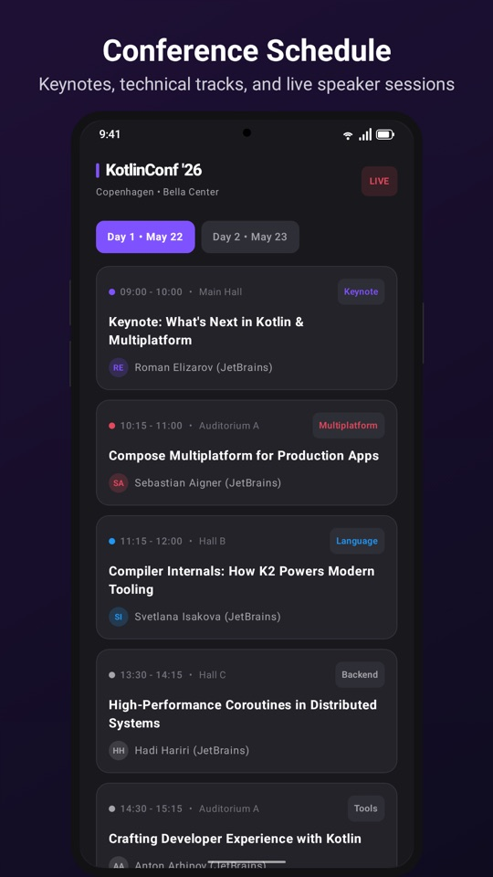
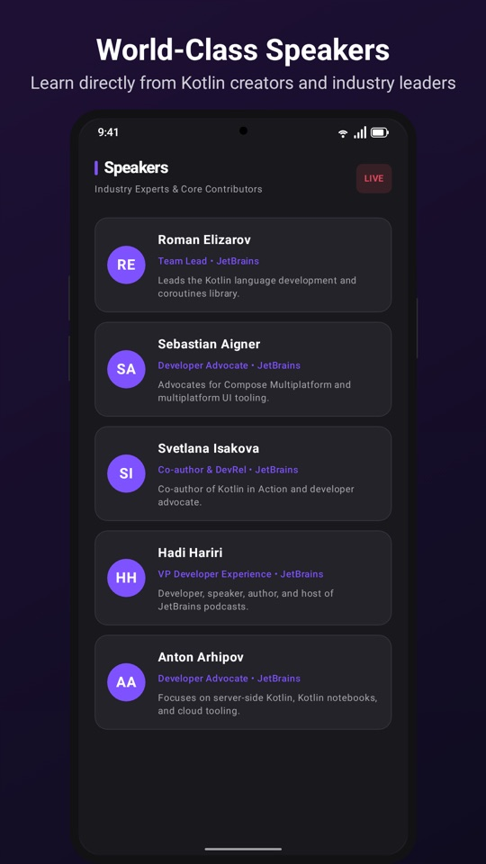
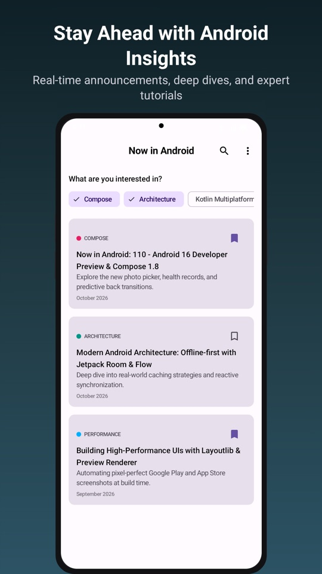
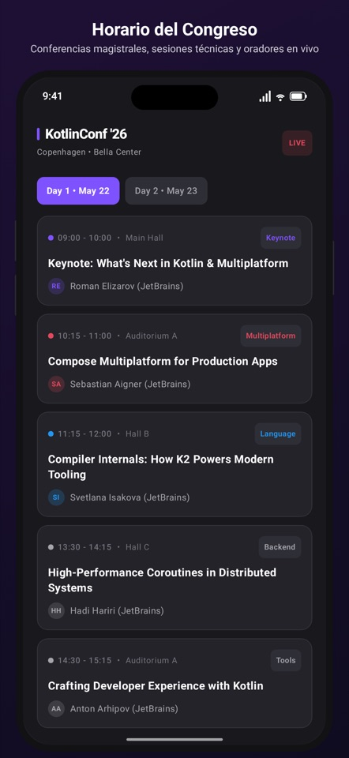
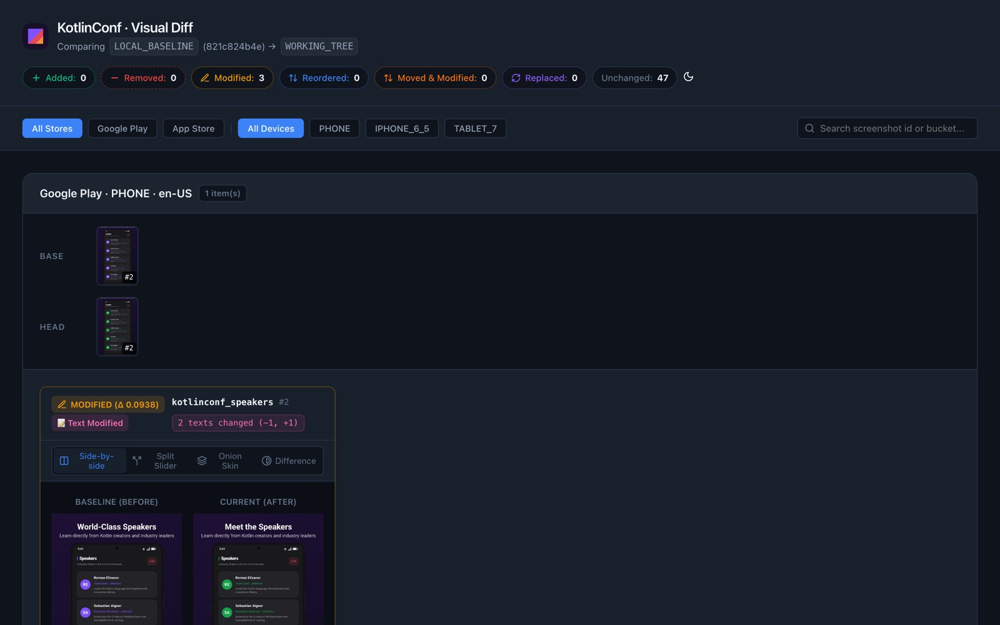
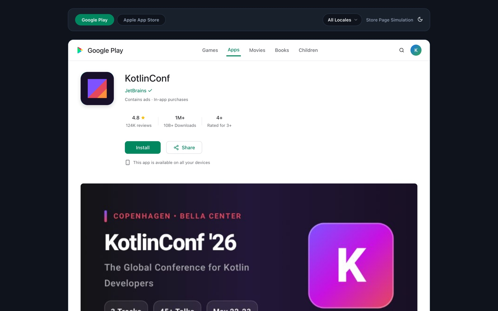

<h1 align="center">
  <br/>
  Chameleon Store Studio
</h1>

<p align="center">
<b>Store screenshots as code for Jetpack Compose and Compose Multiplatform.</b><br/>
Render Google Play and App Store assets from your composables, without an emulator, then export,
validate, review and publish them.
</p>

<p align="center">
  
  
  
  
</p>

> [!WARNING]
> Chameleon Store Studio is **experimental until 1.0.0**: the DSL, annotations and generated file formats
> may change between `0.x` releases. App Store Connect publishing has not been tested against the real
> store yet.

> [!NOTE]
> **Chameleon Store Studio is heavily inspired by [compose-nav-graph](https://github.com/skydoves/compose-nav-graph)
> by [@skydoves](https://github.com/skydoves).** Its approach of turning Compose code into reviewable
> artifacts, with a Gradle plugin that generates them and an IDE tool window that displays them, shaped
> this project from the start. Thank you!

## Why

Store screenshots are usually made by hand: run the app, capture the screen, add headlines and frames
in a design tool, then repeat for every store size and language. They're rejected for small rule
violations, and they quietly drift away from the real app after every redesign.

Chameleon Store Studio makes them part of your codebase:

- **Code, not captures.** Each screenshot is a `@Composable` that reuses your real screens, theme and
  string resources.
- **Rendered headlessly.** Layoutlib (the engine behind Android Studio previews) renders on the JVM,
  with Robolectric as an automatic fallback.
- **Every store, device and locale.** One composable produces all the sizes Google Play and the App
  Store require, in every language you support.
- **Validated.** About fifty Google Play and App Store rules are checked before you upload anything.
- **Reviewed.** Visual and text changes show up in pull requests, compared with the base branch
  rendered on the same machine, without committing images.
- **In your IDE.** A tool window shows the gallery, a simulated store listing, the diff and validation
  results, and jumps to the code behind each image.

## Components

| Component | Description |
|---|---|
| `dev.ribod.storestudio` (Gradle plugin) | Discovers, renders, exports, validates, diffs, reports and publishes. |
| `store-studio-annotations` | `@StoreScreenshot` and `@StoreFeatureGraphic`. |
| `store-studio-ksp` | Compile-time checks and screenshot manifest. |
| `store-studio-runtime` | Canvas, headlines, device mockups, status bars (off by default) and backgrounds (KMP). |
| `store-studio-testing` | Robolectric harness for the fallback renderer. |
| IDE plugin | Tool window for Android Studio and IntelliJ IDEA. |

## Quick start

**1. Add the plugins.** Everything is on Maven Central, so `mavenCentral()` must be in
`pluginManagement` and `dependencyResolutionManagement` (Android Studio projects already have it).
Store Studio adds its libraries and the KSP processor for you.

```kotlin
// build.gradle.kts (root)
plugins {
    id("com.google.devtools.ksp") version "2.3.12" apply false
    id("dev.ribod.storestudio") version "0.1.0" apply false
}

// app/build.gradle.kts
plugins {
    id("com.android.application")
    id("org.jetbrains.kotlin.plugin.compose")
    id("com.google.devtools.ksp")
    id("dev.ribod.storestudio")
}
```

**2. Configure stores and languages.**

```kotlin
storeStudio {
    targets.set(setOf(StoreTarget.PLAY_STORE, StoreTarget.APP_STORE))
    defaultDevices.set(setOf(DeviceFamily.PHONE, DeviceFamily.TABLET))
    locales {
        register("en-US")
        register("es-MX") { playStore.set("es-419") }
    }
}
```

**3. Write a screenshot.**

```kotlin
@StoreScreenshot(id = "agenda", order = 1, name = "Conference Schedule")
@Composable
fun AgendaStoreScreenshot() {
    StoreScreenshotCanvas {
        Headline(stringResource(Res.string.agenda_headline))
        Subheadline(stringResource(Res.string.agenda_subheadline))
        DeviceMockup { AppTheme { AgendaScreen(state = AgendaState.sample()) } }
    }
}
```

**4. Export and validate.**

```bash
./gradlew :app:storeExport     # app/build/store/export/
./gradlew :app:storeValidate   # Google Play and App Store rules
```

Read the [Quick Start](https://ribod.github.io/chameleon-store-studio/quickstart/) for the full
walkthrough.

## Features

### Rendering and export

Every screenshot is rendered for each store slot and locale, then exported at the exact size the store
expects (Google Play phone, 7" and 10" tablets, Wear OS and the 1024×500 feature graphic; App Store
iPhone 6.9", 6.5" and iPad 13"), without transparency and within file size limits.
[Rendering](https://ribod.github.io/chameleon-store-studio/rendering/) ·
[Export](https://ribod.github.io/chameleon-store-studio/export/)

### Validation

About fifty rules cover dimensions, formats, screenshot counts, required device sets, locale coverage,
text overflow and listing text limits. Hard store requirements always fail the build; everything else
is configurable. [Validation](https://ribod.github.io/chameleon-store-studio/validation/)

### Baselines and visual diff

`storeDiff --render-base` renders the base branch on the same machine and compares exactly, pixels and
captured text, so pull requests show every screenshot change without committing a baseline. It
produces an HTML report with slider, onion-skin and difference views. A hash-only committed baseline is
also supported.

<p align="center"></p>

[Baselines & Visual Diff](https://ribod.github.io/chameleon-store-studio/baselines-and-diff/)

### Reports

Self-contained HTML reports, ready to share: a gallery, a simulation of the Google Play and App Store
listings, and the visual diff.

<p align="center"></p>

[HTML Reports](https://ribod.github.io/chameleon-store-studio/reports/)

### CI

`storeCi` validates and diffs in one task, writes a GitHub Actions job summary and keeps a sticky
comment on the pull request (GitHub and GitLab). Renders are cacheable in the Gradle build cache.
[CI Integration](https://ribod.github.io/chameleon-store-studio/ci/)

### Publishing

Publishing supports granular and full-release scopes with `--publish-dry-run` and automated safety checks:

- **Full Release:** Deploy app binaries, store listing texts, images, and release notes together. On Google Play, `storePublishPlay` performs the entire release (AAB, R8 mapping, track release & release notes, localized descriptions, and visual assets) inside a **single atomic Google Play Edit** and commits once (`storePublish` deploys across all configured stores).
- **Listing Only:** Upload visual assets, metadata descriptions, and release notes without uploading a binary using `storePublishPlayListing` (or `storePublishListing`). Granular tasks (`storePublishPlayTexts`, `storePublishPlayImages`, `storePublishPlayReleaseNotes`) allow updating individual listing parts.
- **Binary Only:** Deploy only the application binary (AAB or IPA) and release notes without rendering or updating store listing assets using `storePublishPlayBinary` (or `storePublishBinary`).

Google Play publishing (binary, metadata, and visual assets) is verified end-to-end in production; App Store Connect publishing is available as an experimental feature.
[Publishing](https://ribod.github.io/chameleon-store-studio/publishing/) · [Binary publishing](https://ribod.github.io/chameleon-store-studio/binary-publishing/)

### Kotlin Multiplatform and multi-module

Write screenshots once in `commonMain` with Compose Multiplatform resources, and keep them in feature
modules: the application module merges them all.
[Kotlin Multiplatform](https://ribod.github.io/chameleon-store-studio/multiplatform/) ·
[Multi-Module Projects](https://ribod.github.io/chameleon-store-studio/multi-module/)

### IDE plugin

The **Store Studio** tool window for Android Studio and IntelliJ IDEA shows the gallery with filters
and badges, a store listing preview, the diff and validation results. Double-click any image to open
its composable. Install it from the
[GitHub releases](https://github.com/ribod/chameleon-store-studio/releases) until it's available on the
JetBrains Marketplace. [IDE Plugin](https://ribod.github.io/chameleon-store-studio/ide/)

## Documentation

- English: <https://ribod.github.io/chameleon-store-studio/>
- AI assistants: [setup guide for coding agents](https://ribod.github.io/chameleon-store-studio/plugin-agent-guides/)

## Requirements

JDK 17+ for the Gradle plugin and libraries, JDK 21 to build the IDE plugin from source, Gradle 9.3+, Kotlin 2.4, Android Gradle Plugin 9.1, KSP 2.3, min SDK 24. The IDE plugin
requires Android Studio or IntelliJ IDEA 2024.2+.

## Samples

- [`samples/sample-kotlinconf`](samples/sample-kotlinconf): Compose Multiplatform, both stores,
  English and Spanish.
- [`samples/sample-nowinandroid`](samples/sample-nowinandroid): multi-module app with store metadata.

## License

```text
Copyright 2026 ribod

Licensed under the Apache License, Version 2.0 (the "License");
you may not use this file except in compliance with the License.
You may obtain a copy of the License at

   http://www.apache.org/licenses/LICENSE-2.0

Unless required by applicable law or agreed to in writing, software
distributed under the License is distributed on an "AS IS" BASIS,
WITHOUT WARRANTIES OR CONDITIONS OF ANY KIND, either express or implied.
See the License for the specific language governing permissions and
limitations under the License.
```
