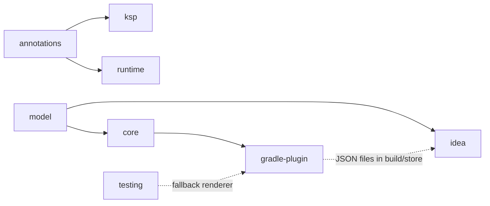

# Architecture & Design

## Modules

| Module | Role |
|---|---|
| `store-studio-annotations` | `@StoreScreenshot`, `@StoreFeatureGraphic` and the shared enums (KMP). |
| `store-studio-ksp` | KSP processor: validates annotated functions and writes `store-manifest.json`. |
| `store-studio-runtime` | Compose building blocks (canvas, mockups, backgrounds, context) (KMP). |
| `store-studio-model` | JSON contracts shared by every component (manifest, index, reports, baseline). |
| `store-studio-core` | Export, validation rules, diff, metadata, reports and store API clients. |
| `store-studio-testing` | Robolectric harness used by the fallback renderer. |
| `store-studio-gradle-plugin` | The Gradle plugin: tasks, DSL, Layoutlib renderer orchestration. |
| `store-studio-idea` | The IDE plugin. |

## Key decisions

- **Layoutlib by default, Robolectric as fallback.** Layoutlib is fast and matches Android Studio
  previews; Robolectric covers the code Layoutlib can't run.
- **Rendering in separate processes.** Renderers run in their own JVMs, so their memory and native
  libraries never affect the Gradle daemon.
- **Compile-time discovery with KSP.** No classpath scanning at render time; invalid declarations
  fail the build early.
- **JSON contracts between components.** The Gradle plugin, reports and IDE plugin communicate
  only through versioned JSON files in `build/store/`.
- **Hash-only baselines.** No binary files in the repository.
- **Direct store API clients.** Publishing talks to the Google Play Developer API and App Store
  Connect API directly, without external tools.
- **Explicit publish tasks.** Publishing never runs as a side effect of another task.
