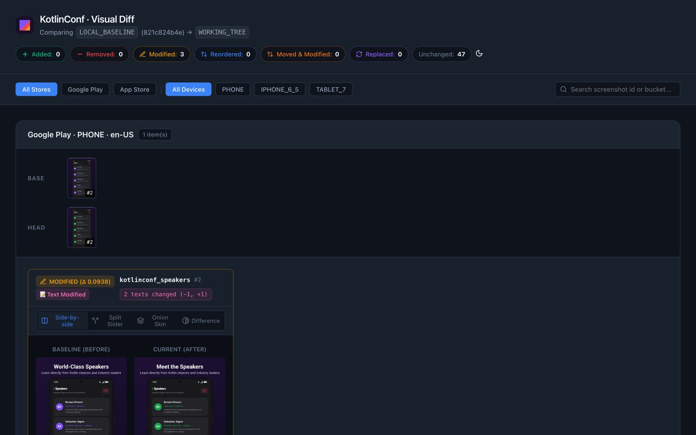

# Baselines & Visual Diff

Chameleon Store Studio compares your current screenshots with a **base**, the version you consider approved,
and tells you exactly which images and texts changed, so screenshot changes can be reviewed like
code.

{ .doc-screenshot }

## Compare on the same machine

Layoutlib renders deterministically: the same code on the same machine produces the same pixels. The
same code rendered on macOS, Windows and Linux can still differ by a few pixels, because the native
graphics library is built separately for each platform.

So the rule is simple: **compare two renders made on the same kind of machine**. Store Studio offers
three ways to get the base:

| Base | How | Best for |
|---|---|---|
| **The base branch, rendered here** | `storeDiff --render-base` | Local work and CI, with no setup. |
| **An export of the base branch** | `storeDiff --base-export=<dir>` | CI, reusing the export of the last `main` build. |
| **A committed baseline** | `storeRecordBaseline` + `.store/baseline.json` | Projects without CI, or a single machine. |

The first two don't require committing anything, and approving a change is simply merging the pull
request: the next build of `main` becomes the new base.

### Render the base branch

```bash
# Base: the merge base with origin/main (or main)
./gradlew :app:storeDiff --render-base

# Base: any branch, tag or commit
./gradlew :app:storeDiff --render-base --against=v1.2.0
```

Store Studio checks out the base revision in a temporary Git worktree, runs this module's
`storeExport` there once, compares, and removes the worktree. It uses the same Gradle build cache,
so screens that didn't change are usually restored instead of rendered: in the KotlinConf sample the
whole comparison takes about 30 seconds. The base build's log is kept in
`build/store/diff/base-render/base-render.log`.

`local.properties` (with `sdk.dir`) is copied into the worktree, since it isn't committed.

### Compare with an existing export

When a CI build of `main` already produced `build/store/export`, download it and compare against it
without rendering again:

```bash
./gradlew :app:storeDiff --base-export=base-export
```

The path is relative to the root project. You can also set it in the build with
`baseline { baseExportDir.set(…) }`. See [CI Integration](ci.md) for a complete workflow.

### Commit a baseline

```bash
./gradlew :app:storeRecordBaseline   # approve the current export
git add app/.store/baseline.json
./gradlew :app:storeVerify           # fail if anything changed since
```

The baseline is a single JSON file with one entry per image: its slot key, position, pixel hash,
perceptual hash and captured text. **No images are committed.** Record and verify it on the same kind
of machine; if your team develops on macOS or Windows and CI runs on Linux, prefer rendering the base
branch instead.

`storeDiff` without options compares against the committed baseline at the merge base with
`origin/main`, or against the file on disk. `--against=<ref>` (without `--render-base`) reads the
baseline committed at that ref.

When no baseline has been recorded, `storeVerify` is skipped with a notice. Set
`baseline { required.set(true) }` to make it fail instead.

## What counts as a change

| `baseline.comparison` | An image changed when |
|---|---|
| `STRICT` (default) | any pixel differs, or the captured text differs. |
| `PERCEPTUAL` | the perceptual distance exceeds `perceptualThreshold` (`0.05`), or the captured text differs. |

Use `STRICT` whenever both sides are rendered on the same kind of machine; it catches every change,
including color-only changes. `PERCEPTUAL` exists for the case where you can't avoid comparing renders
from different operating systems: it summarizes each image as a 64-bit hash of its grayscale
structure, so it tolerates antialiasing differences but can miss small changes such as a color tweak.
Text changes are detected exactly in both modes, because the text captured while rendering doesn't
depend on the platform.

## Diff reports

```bash
./gradlew :app:storeDiff          # build/store/diff/diff.json
./gradlew :app:storeDiffReport    # build/store/reports/diff.html + diff-summary.md
```

Each image is classified as:

| Status | Meaning |
|---|---|
| Added / Removed | The screenshot exists only in the current export or only in the base. |
| Modified | Same slot, different image or text. A **text modified** tag lists removed and added lines. |
| Reordered | Same image, different `order`. |
| Moved & Modified | Reordered and changed. |
| Replaced | A different screenshot now occupies the position. |
| Unchanged | Identical. |

The HTML report says what it compared against (for example "`main` rendered on this machine"),
groups changes by store, device and locale, and offers side-by-side, slider, onion skin and
difference views. Unchanged images are hidden unless you pass `--include-unchanged` to
`exportStoreDiffHtml` (or set `reports.includeUnchangedInDiff`).

`diff-summary.md` is a compact Markdown summary meant for pull request comments and CI job summaries;
see [CI Integration](ci.md).

## Options when another task runs the diff

Command-line options only reach the task you name. When `storeDiff` runs as a dependency, for
example of `storeCi` or `storeDiffReport`, use Gradle properties instead:

| Property | Same as |
|---|---|
| `-PstoreStudio.diff.renderBase=true` | `--render-base` |
| `-PstoreStudio.diff.against=<ref>` | `--against=<ref>` |
| `-PstoreStudio.diff.baseExport=<dir>` | `--base-export=<dir>` |

!!! tip "Shallow clones"
    Comparing against a ref needs that ref in your clone. In CI, use `fetch-depth: 0` (GitHub
    Actions) or fetch the branch explicitly; Store Studio tells you when the clone is too shallow.

## In the IDE

The [Changes & Diff](ide/diff.md) tab shows the same comparison with a slider. It can compare against
the committed baseline or render the base branch on your machine.
