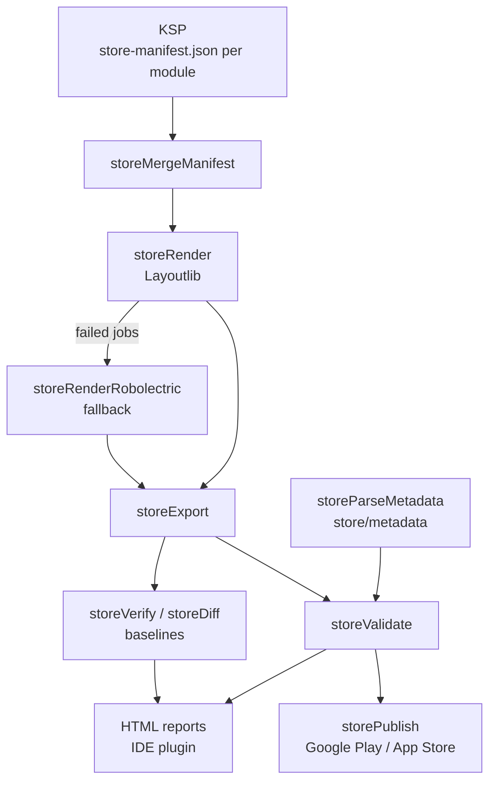

# Core Concepts

## Targets, device families and slots

A **target** is a store: `PLAY_STORE` or `APP_STORE`.

A **device family** is what you choose in code or configuration: `PHONE`, `TABLET`, `TABLET_7`,
`WATCH` and so on.

A **slot** is a concrete store category with exact pixel dimensions. Each device family maps to one
or more slots per store:

| Device family | Google Play slot | App Store slot |
|---|---|---|
| `PHONE` | `PHONE` 1080 × 1920 | `IPHONE_6_9` 1320 × 2868 (+ `IPHONE_6_5` 1284 × 2778 if enabled) |
| `TABLET_7` | `TABLET_7` 1200 × 1920 | `IPAD_13` 2064 × 2752 |
| `TABLET` | `TABLET_10` 1600 × 2560 | `IPAD_13` 2064 × 2752 |
| `WATCH` | `WEAR` 512 × 512 | — |
| *(feature graphic)* | `FEATURE_GRAPHIC` 1024 × 500 | — |

`DESKTOP`, `TV`, `AUTO` and `XR` exist in the `DeviceFamily` enum but don't produce screenshots yet.
The `IPHONE_6_5` set is added with `appStore { extraIphoneSizes.set(setOf("IPHONE_6_5")) }`.

## Locales

Locales are BCP-47 language tags such as `en-US` or `es-MX`. Each locale renders every screenshot
with your localized resources. Stores sometimes use different codes for the same language; you can
map them per store (`playStore.set("es-419")`).

## Jobs and slot keys

Every combination of screenshot × target × slot × locale is one **render job**, identified by a
job id such as `home__PLAY_STORE__PHONE__en-US`. After export, each image is identified by its
**slot key**, `PLAY_STORE/PHONE/en-US/home`, which is what baselines, diffs and validation reports
refer to.

A project with 4 screenshots, both stores, phone and tablet, and 2 locales produces
4 × (2 Play slots + 2 App Store slots) × 2 locales = **32 images**.

## The pipeline

Each step is a Gradle task with declared inputs and outputs: unchanged steps are skipped, and the
expensive render step can be reused from the Gradle build cache.

## Where the artifacts live

Everything is generated under the module's `build/store/` directory, except the optional committed
baseline:

| Path | Produced by | Contents |
|---|---|---|
| `build/store/manifest/merged.json` | `storeMergeManifest` | All screenshots of the module and its dependencies |
| `build/store/render/index.json`, `render/raw/` | `storeRender` | Layoutlib results and raw images |
| `build/store/render/robolectric/` | `storeRenderRobolectric` | Results of the fallback renderer |
| `build/store/semantics/` | renderers | Text extracted from each screenshot |
| `build/store/export/` | `storeExport` | Final store-ready images and `index.json` |
| `build/store/metadata/metadata.json` | `storeParseMetadata` | Parsed listing text |
| `build/store/validation/report.json` | `storeValidate` | Validation findings |
| `build/store/diff/diff.json` | `storeDiff` | Changes against the base revision |
| `build/store/reports/*.html` | report tasks | Gallery, listing preview and diff reports |
| `.store/baseline.json` | `storeRecordBaseline` | Approved hashes, if you commit a baseline |

The IDE plugin reads these same files.
