# Samples

The repository includes two complete sample projects. Every image on this site was rendered from
them.

## KotlinConf (Compose Multiplatform)

[`samples/sample-kotlinconf`](https://github.com/ribod/chameleon-store-studio/tree/main/samples/sample-kotlinconf)
is based on the KotlinConf app. It shows:

- screenshots written once in `commonMain` and rendered for Google Play and the App Store;
- Compose Multiplatform resources in English and Spanish (`es-MX`, published as `es-419` on Google
  Play);
- phone, 7-inch and 10-inch tablet, iPhone 6.9" and 6.5", and iPad 13" sets;
- a custom feature graphic and export background.

<div class="store-showcase store-showcase--small" markdown>
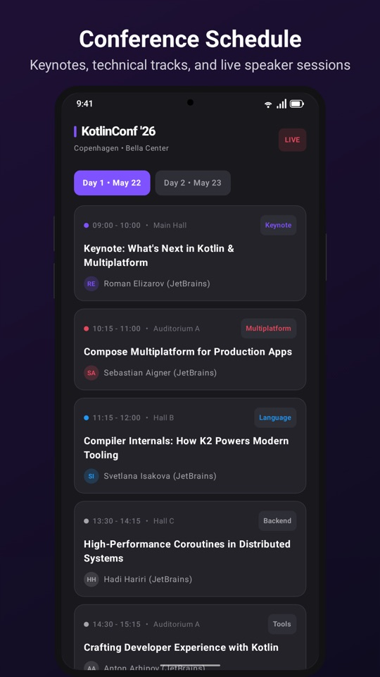
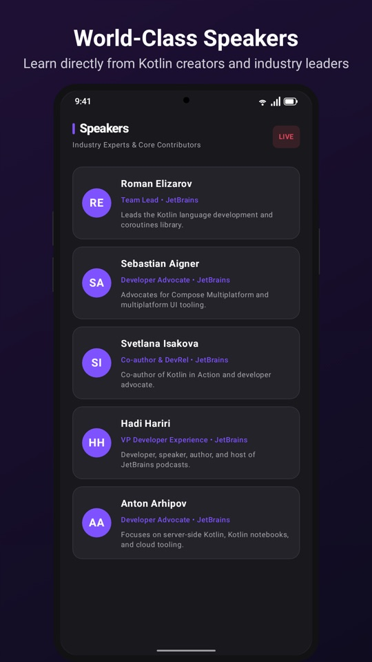
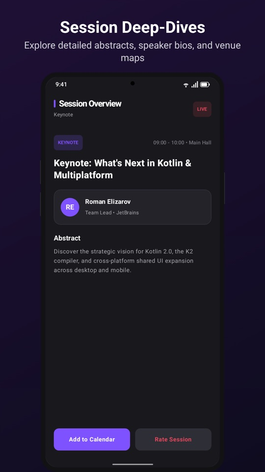
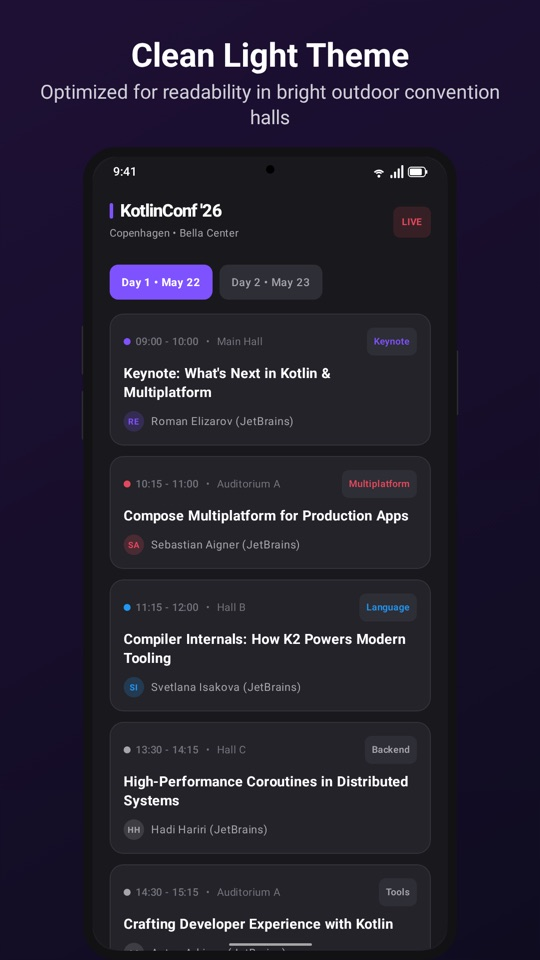
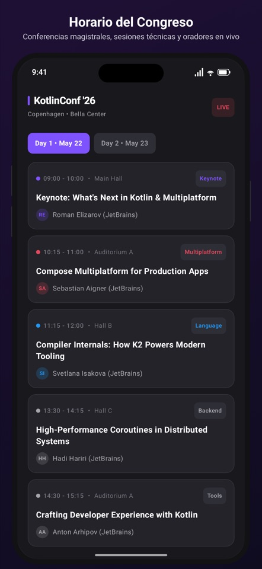
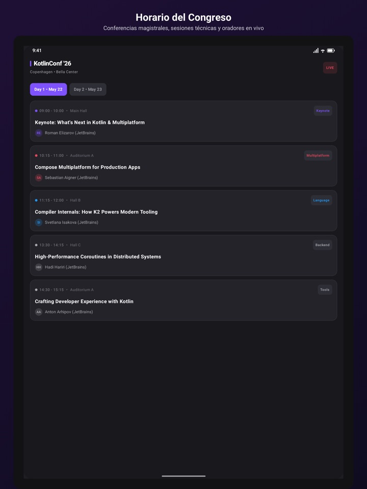
</div>

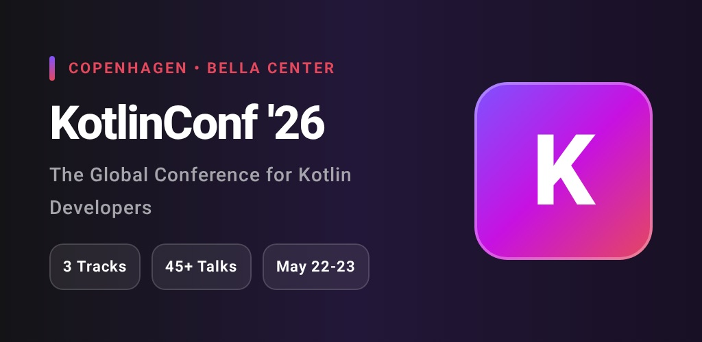

## Now in Android (multi-module)

[`samples/sample-nowinandroid`](https://github.com/ribod/chameleon-store-studio/tree/main/samples/sample-nowinandroid)
is based on Google's Now in Android. It shows:

- screenshots in three feature modules (`:feature:foryou`, `:feature:interests`,
  `:feature:bookmarks`) merged by `:app`;
- light and dark theme variants;
- store metadata in `app/store/metadata` for both stores and two locales.

<div class="store-showcase store-showcase--small" markdown>
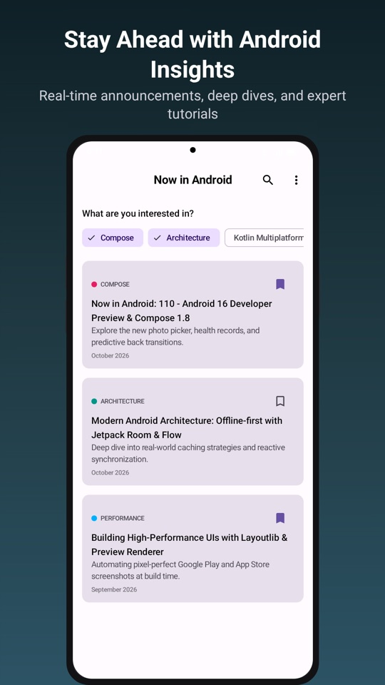
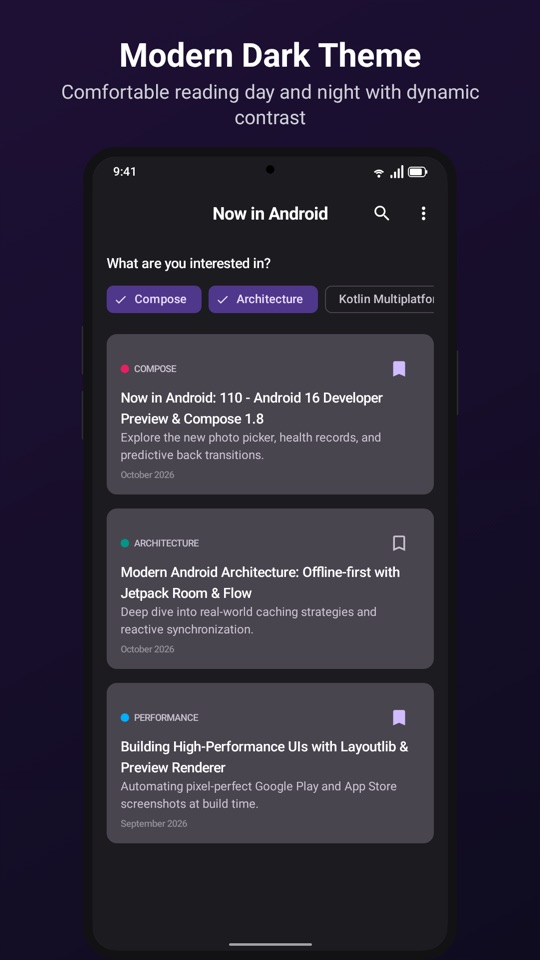
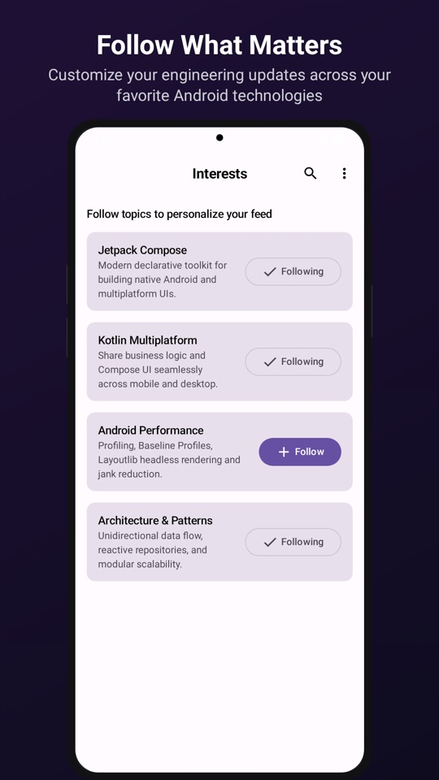
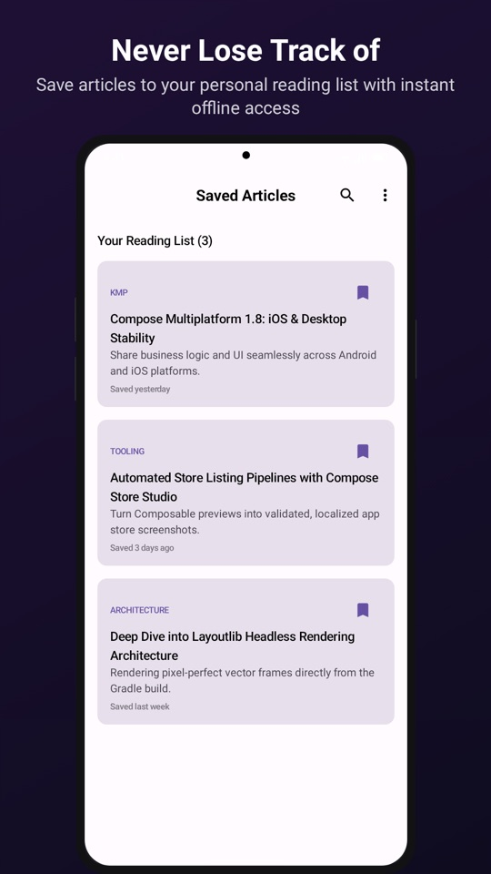
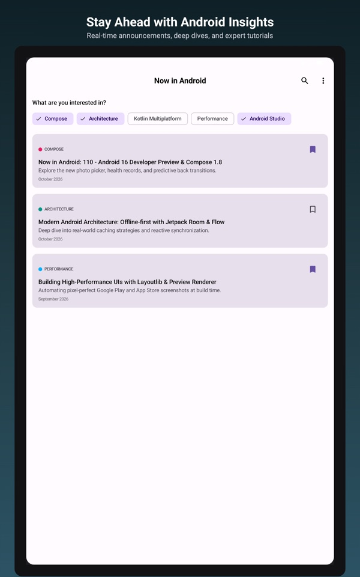
</div>


## Running them

The samples build Chameleon Store Studio from source, so clone the repository and run them with its wrapper:

```bash
./gradlew -p samples/sample-kotlinconf :app:storeExport :app:storeGallery
```
