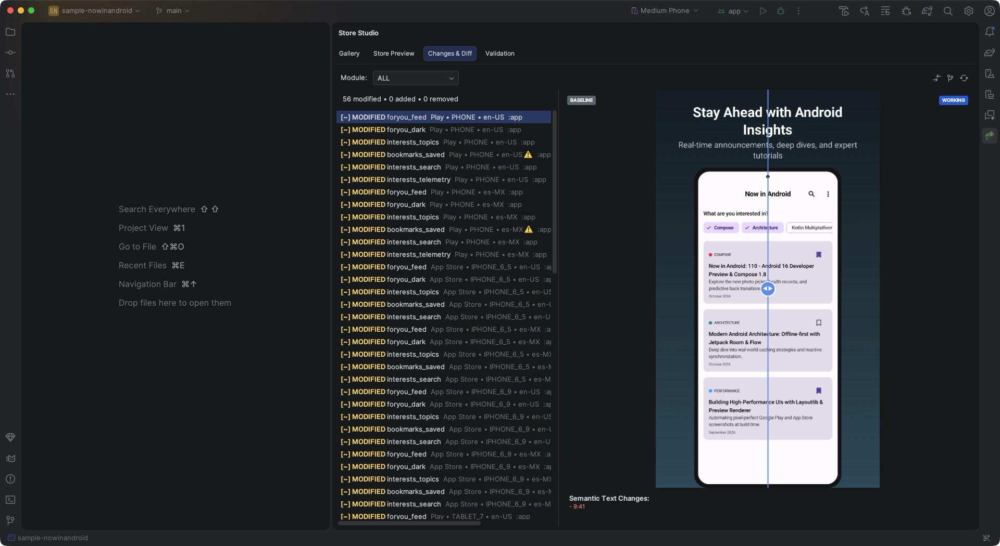

# Changes & Diff

The Changes & Diff tab shows what changed in your screenshots compared with a
[base](../baselines-and-diff.md): the base branch rendered on your machine, or a committed baseline.

{ .doc-screenshot }

## Using it

The toolbar has two ways to compute the diff:

- **Compare with Base Branch** renders the base branch on your machine and compares
  (`storeDiff --render-base`). The base is the merge base with `origin/main` (or `main`), or the branch
  set in [Settings](settings.md). No baseline is needed.
- **Run storeDiff** compares against the committed baseline, if your project records one.

The tab lists every changed image with its status (added, removed, modified, reordered, or moved and
modified) and says what it compared against. Select a change to compare the base and current image
with a **slider**. When the captured text changed, the **Semantic Text Changes** section lists the
removed and added lines.

Use **Refresh** after running the diff from the command line.
