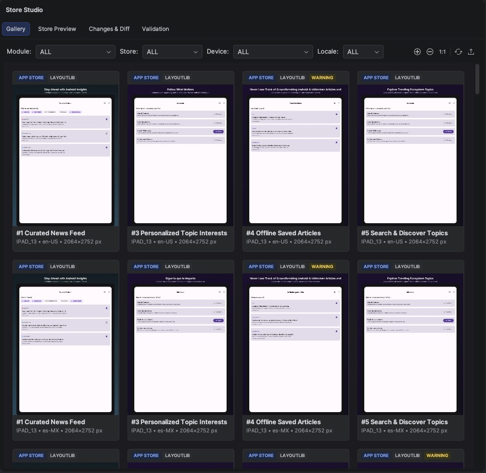

# Gallery

The Gallery tab shows every exported image of the project as a grid of cards.

{ .doc-screenshot }

## Filters

Use the filters at the top to narrow the grid:

- **Module**, for multi-module projects;
- **Store** (Google Play, App Store or both; the default is set in [Settings](settings.md));
- **Device** (phone, 7-inch tablet, 10-inch tablet, iPhone, iPad, Wear OS, feature graphic);
- **Locale**.

## Cards and badges

Each card shows the image, its name and position in the carousel, plus optional badges:

| Badge | Meaning |
|---|---|
| Device slot (`PHONE`, `TABLET_7`, `IPAD_13`…) | Which store slot the image is for. |
| `LAYOUTLIB` / `ROBOLECTRIC` | Which engine rendered it. `ROBOLECTRIC` means the fallback was needed; see [Rendering](../rendering.md). |
| `ERROR` / `WARNING` | The image has [validation](validation.md) findings. |

Each badge type can be turned off in [Settings](settings.md).

## Actions

- **Double-click** a card to open the `@StoreScreenshot` composable that produced it.
- **Right-click** a card for **Jump to Composable Source**, **Open Image in Editor**,
  **Copy Image Path** and **Copy Slot Key**.

When a screenshot contains text that was cut off, the card shows a text-overflow warning, typically
caused by a long translation.
