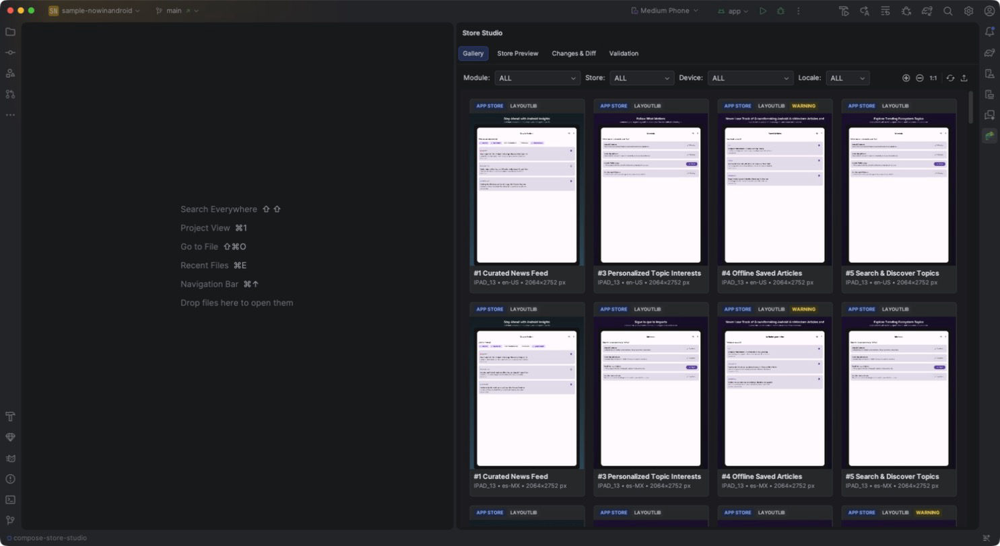
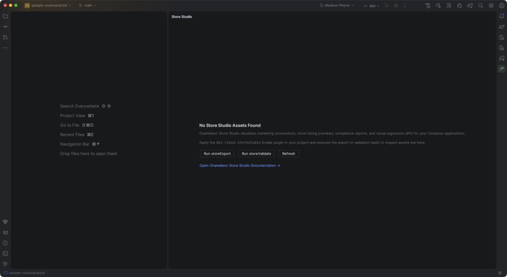

# IDE Plugin

The Chameleon Store Studio plugin for **Android Studio** and **IntelliJ IDEA** adds a **Store Studio**
tool window that shows the artifacts generated by the Gradle plugin, right next to your code.

{ .doc-screenshot }

## Installation

!!! info "JetBrains Marketplace: coming soon"
    Install the plugin from disk until it's listed on the Marketplace.

1. Download `store-studio-idea-<version>.zip` from the
   [GitHub releases](https://github.com/ribod/chameleon-store-studio/releases).
2. Open **Settings → Plugins**, click the gear icon and choose **Install Plugin from Disk…**.
3. Select the zip and restart the IDE.

Requires Android Studio or IntelliJ IDEA 2024.2 or newer.

## How it works

The plugin doesn't render anything itself: it reads the files in each module's `build/store/`
directory (export index, validation report, diff, metadata) and runs the Gradle tasks for you when
you click a toolbar action. Anything you generate from the command line or CI shows up in the IDE,
and the other way around.

When a Gradle build finishes, the tool window reloads automatically (configurable in
[Settings](settings.md)).

## Tabs

| Tab | What it shows |
|---|---|
| [Gallery](gallery.md) | Every exported image, filtered by module, store, device and locale. |
| [Store Preview](store-preview.md) | A simulated Google Play or App Store listing page. |
| [Changes & Diff](diff.md) | Visual and text changes against the base branch or a baseline. |
| [Validation](validation.md) | Store rule findings, with jumps to the source. |

The toolbar also has **Refresh**, actions to run `storeExport`, `storeValidate` and `storeDiff`, and
**Publish…**, which opens the [Publish dialog](publishing.md).

## First run

If no module has generated assets yet, the tool window shows a short setup guide: apply the
`dev.ribod.storestudio` plugin and run the export.

{ .doc-screenshot }
