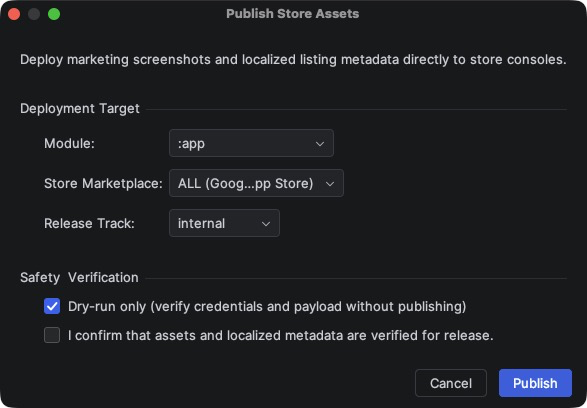

# Publishing

**Publish…** in the tool window toolbar opens the **Publish Store Assets** dialog, which runs the
[`storePublish`](../publishing.md) task for you.

{ .doc-screenshot }

| Field | Description |
|---|---|
| **Store Marketplace** | Google Play, App Store, or both. |
| **Release Track** | Google Play track that receives the release notes: `internal`, `alpha`, `beta` or `production`. |
| **Dry-run only** | Enabled by default. Verifies credentials and shows the upload plan without publishing. |
| **Confirmation** | You must confirm that assets and metadata are verified for release before publishing for real. |

Credentials are read from your `publishing { }` configuration or environment variables, exactly as
on the command line. The task output appears in the IDE's Run window.

!!! warning "App Store Connect is experimental"
    Publishing to App Store Connect has not been tested against the real store yet. See
    [Publishing](../publishing.md#app-store-connect).
