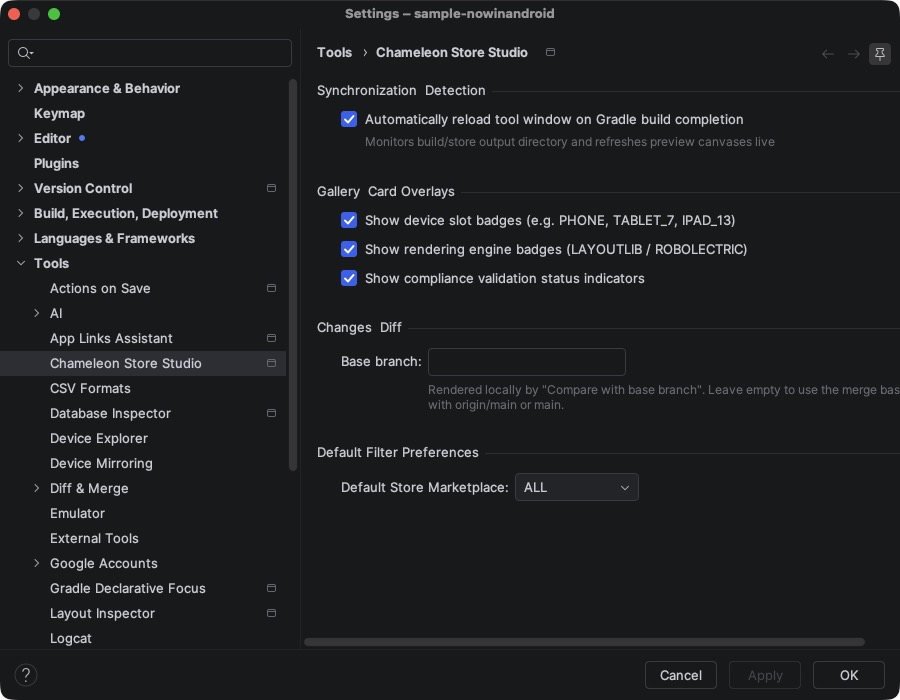

# Settings

Open **Settings → Tools → Chameleon Store Studio**. Settings are stored per project.

{ .doc-screenshot }

| Setting | Default | Description |
|---|---|---|
| Automatically reload tool window on Gradle build completion | On | Refreshes the tabs when a build that touches `build/store` finishes. |
| Show device slot badges | On | `PHONE`, `TABLET_7`, `IPAD_13`… on gallery cards. |
| Show rendering engine badges | On | `LAYOUTLIB` / `ROBOLECTRIC` on gallery cards. |
| Show compliance validation status indicators | On | `ERROR` / `WARNING` on gallery cards. |
| Default Store Marketplace | All | Store filter preselected in the gallery. |
| Base branch | empty | Branch rendered by **Compare with Base Branch**. Empty uses the merge base with `origin/main` or `main`. |

Store Studio's build configuration (stores, devices, locales, rendering) lives in Gradle, not in the
IDE; see [Configuration](../configuration.md).
