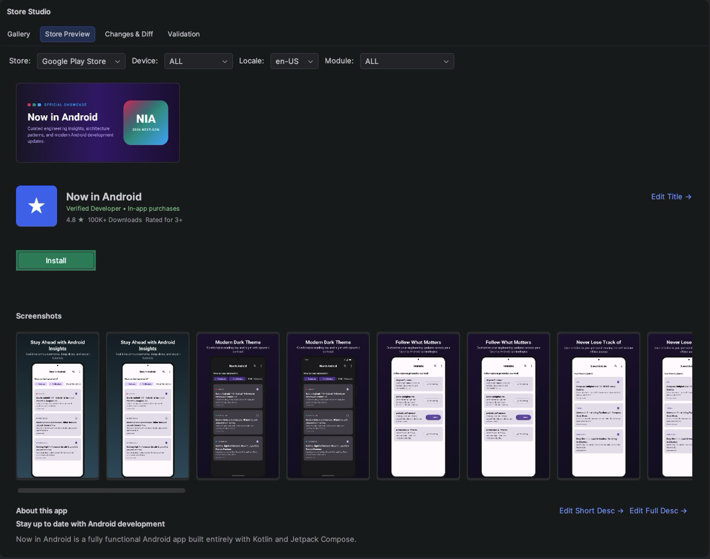
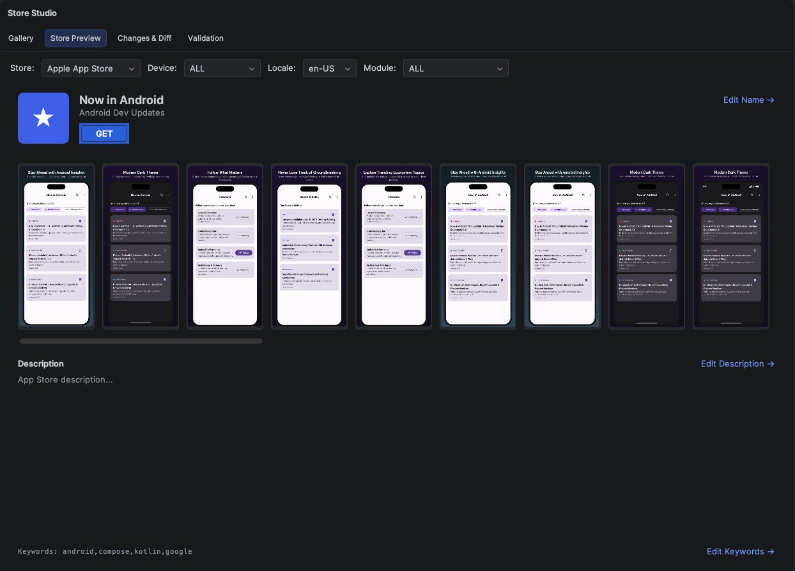

# Store Preview

The Store Preview tab simulates how your listing will look on **Google Play** and the **App Store**,
using the exported screenshots, the feature graphic and the [store metadata](../metadata.md) text.

{ .doc-screenshot }

{ .doc-screenshot }

Choose the module, store, device and locale at the top to switch between listings. The preview
shows:

- the title, subtitle and descriptions from your metadata, in the selected locale;
- the screenshot carousel in store order, and the Google Play feature graphic;
- the app icon of each store, set with [`icons { }`](../configuration.md#icons). Double-click it to open
  the file. Without an icon, the Chameleon logo is shown instead.

Use **Zoom In**, **Zoom Out** and **Reset Zoom** to inspect details.

Use it to check how the first screenshots read together, whether headlines are readable at store
size, and how translations fit.

The same simulation is available as a shareable HTML file with `./gradlew storeListingPreview`; see
[HTML Reports](../reports.md).
