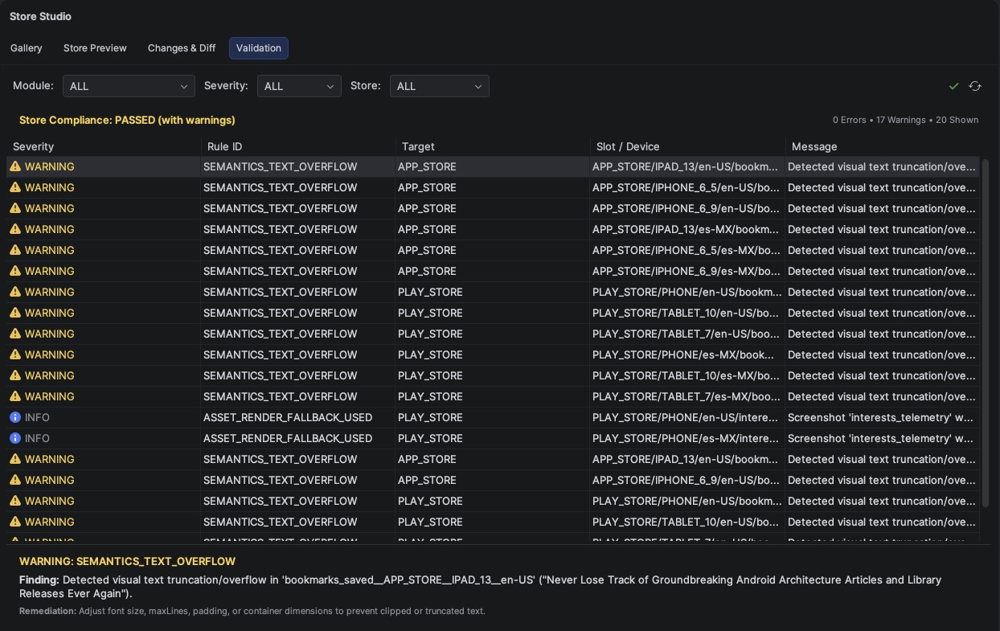

# Validation

The Validation tab shows the result of `storeValidate`: an overall status and the list of findings.

{ .doc-screenshot }

The header summarizes the result:

- **Store Compliance: PASSED**: no findings that block publishing;
- **PASSED (with warnings)**: there are warnings to review;
- **FAILED**: at least one error; the stores would reject these assets.

Each finding shows its severity, rule id, target and message. **Double-click** a finding to jump to
the screenshot's source. The full list of rules and how to change their severity is in
[Validation](../validation.md).

Use **Run store compliance validation** in the toolbar to run `storeValidate`, or **Reload
validation report** after running it from the command line.
