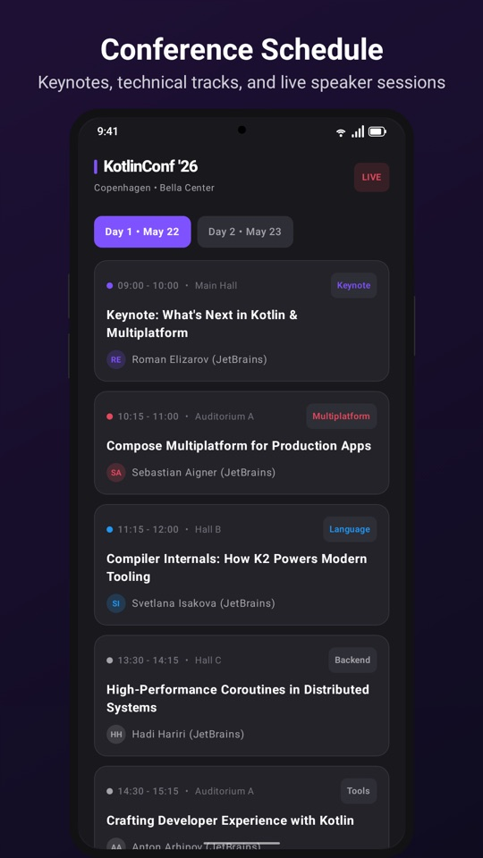
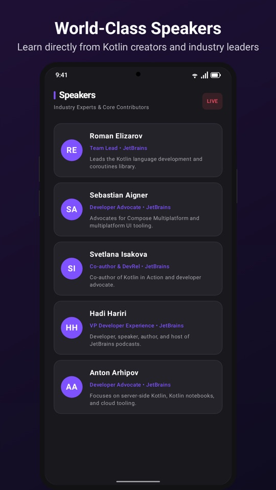
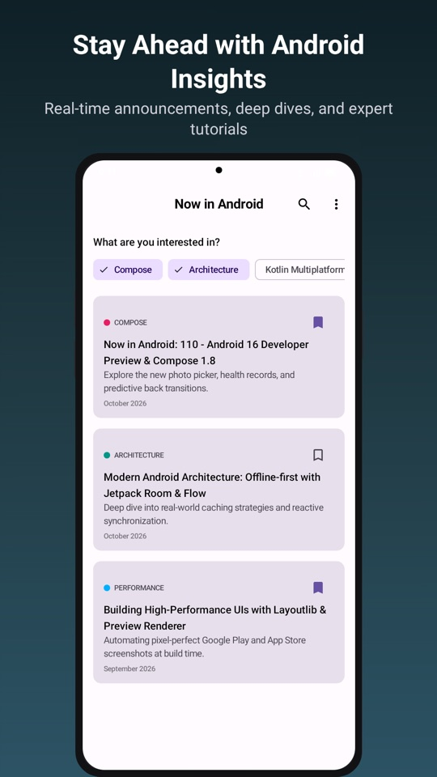
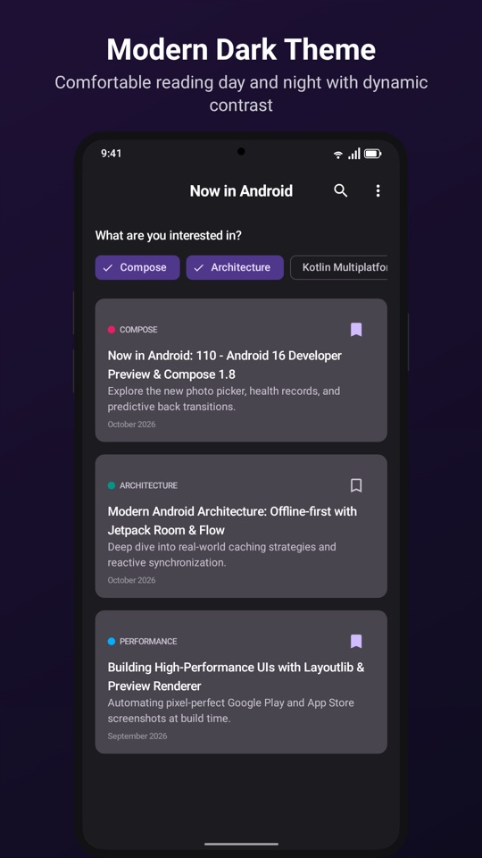
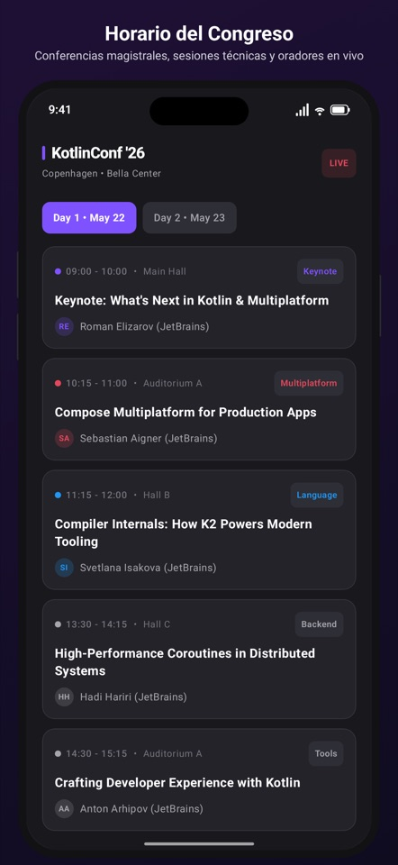
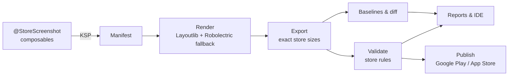

---
hide:
  - navigation
---

# Chameleon Store Studio

**Store screenshots as code for Jetpack Compose and Compose Multiplatform.**

Chameleon Store Studio turns `@Composable` functions into the screenshots, feature graphics and listing
assets that Google Play and the App Store require. It renders them headlessly (no emulator, no
device), exports them at the exact sizes each store accepts, validates them against store rules, lets
you review visual and text changes in pull requests, and can publish them to the store consoles.

<small>Real output of the [samples](guides/samples.md): every image above was rendered from Compose
code by `./gradlew storeExport`.</small>

!!! note "Inspired by compose-nav-graph"
    Chameleon Store Studio is heavily inspired by
    [compose-nav-graph](https://github.com/skydoves/compose-nav-graph) by
    [skydoves](https://github.com/skydoves), whose approach to turning Compose code into reviewable
    artifacts with a Gradle plugin and an IDE tool window shaped this project.

!!! warning "Experimental until 1.0.0"
    The DSL, annotations and artifact formats may still change between `0.x` releases. See
    [Stability](stability.md).

## How it works

1. **Write** a screenshot as a top-level composable annotated with
   [`@StoreScreenshot`](annotations.md), using your real screens inside a
   [`StoreScreenshotCanvas`](composing.md) with headlines and device frames.
2. **Render** every screenshot for every store, device and locale with `./gradlew storeExport`.
3. **Check** the result with [`storeValidate`](validation.md), the [HTML reports](reports.md) or the
   [IDE plugin](ide/index.md).
4. **Review** changes in pull requests with [baselines and visual diffs](baselines-and-diff.md), and
   **publish** to the consoles when you are ready.

## Components

| Component | What it does |
|---|---|
| **Gradle plugin** `dev.ribod.storestudio` | Discovers screenshots, renders, exports, validates, diffs, reports and publishes. |
| **Annotations** `store-studio-annotations` | `@StoreScreenshot` and `@StoreFeatureGraphic` to mark composables. |
| **KSP processor** `store-studio-ksp` | Validates annotated functions at compile time and writes the screenshot manifest. |
| **Runtime** `store-studio-runtime` | Compose building blocks for screenshots: canvas, headlines, device mockups, backgrounds. |
| **Testing** `store-studio-testing` | Robolectric runner used by the fallback renderer. |
| **IDE plugin** | A tool window for Android Studio and IntelliJ IDEA to browse, preview, diff and validate assets. |

The Gradle plugin adds the annotations, runtime and KSP processor to your module automatically, so
applying the plugin is usually all the setup you need.

## Where to start

-   **[Why Store Studio](why.md)**

    The problem it solves and what it deliberately doesn't do.

-   **[Quick Start](quickstart.md)**

    Your first exported screenshot in a few minutes.

-   **[Configuration](configuration.md)**

    Stores, devices, locales and every option of the `storeStudio { }` DSL.

-   **[IDE Plugin](ide/index.md)**

    Browse and review assets without leaving Android Studio.

