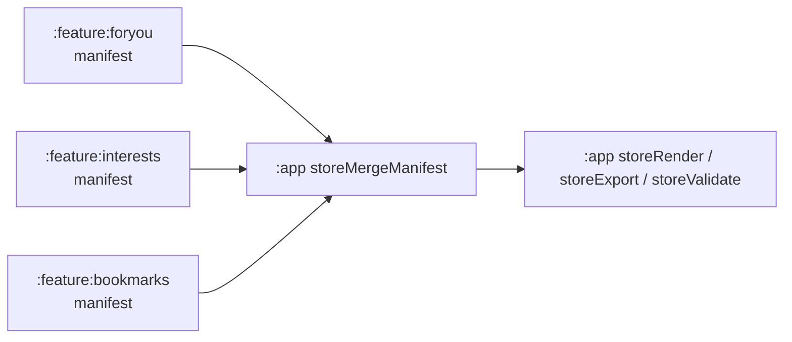

# Multi-Module Projects

In modular apps, screenshots usually live next to the screens they show, in feature modules. Store
Studio supports this directly.

## Setup

Apply the plugin (and KSP) to every module that declares screenshots, and to the application module:

```kotlin title="feature/foryou/build.gradle.kts"
plugins {
    id("com.android.library")
    id("org.jetbrains.kotlin.plugin.compose")
    id("com.google.devtools.ksp")
    id("dev.ribod.storestudio")
}
```

Configure stores, devices and locales in the **application module**, which produces the listing.

## How aggregation works

- Each module's KSP processor writes its own `store-manifest.json`.
- `storeMergeManifest` in a module combines its manifest with those of the **project dependencies**
  that also apply the plugin. The application module therefore sees every screenshot of the app.
- Screenshot ids must be **unique across all merged modules**. A duplicate fails the merge and names
  both source files.
- `order` is global: give screenshots from different modules distinct positions.



## Running tasks

```bash
./gradlew :app:storeExport       # the whole listing
./gradlew storeExport            # every module, each with its own screenshots
```

Library modules can render their own screenshots (with `rendering.configureLibraryResources`,
default `true`), which is handy while working on one feature. Validation in library modules only runs
per-image rules; the listing rules (counts, required sets, feature graphic, locale coverage) run in
the application module. See [Validation](validation.md#application-and-library-modules).

The render limit `maxParallelProcesses` is shared by the whole build, so running
`./gradlew storeExport --parallel` across many modules doesn't overload the machine.

The [Now in Android sample](guides/samples.md) uses this layout with three feature modules.
