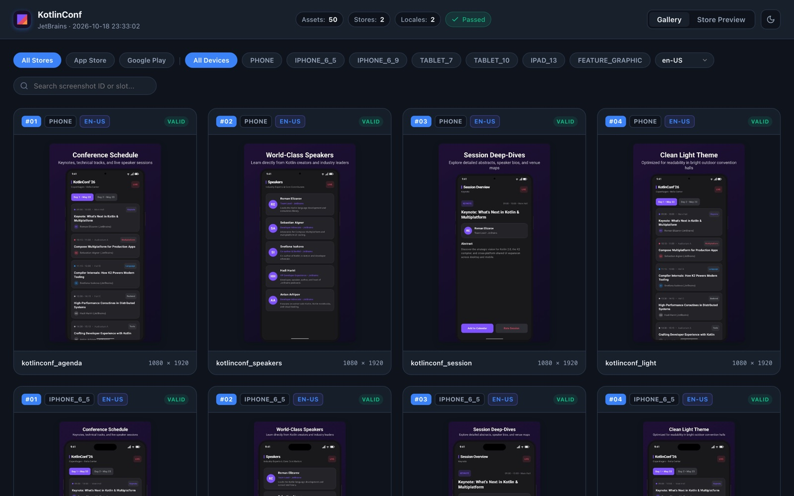
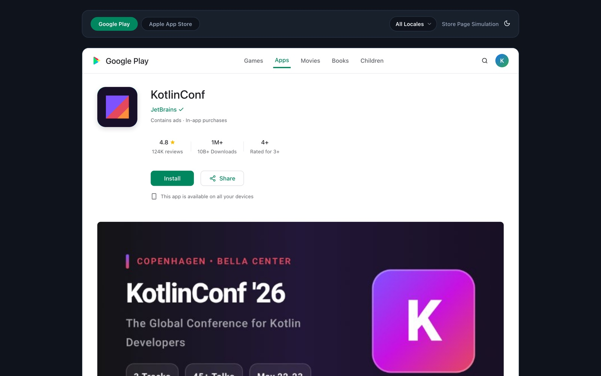
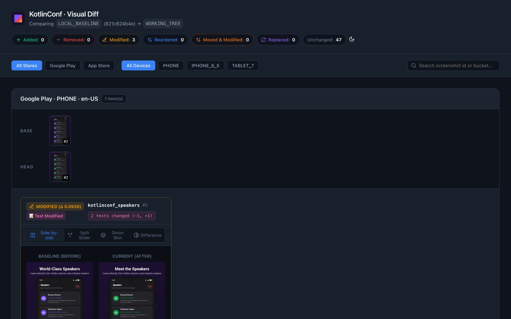

# HTML Reports

Chameleon Store Studio generates self-contained HTML reports that you can open locally, attach to CI runs or
share with designers and product managers who don't use Android Studio. Each report is a single
file with light and dark themes.

| Report | Task | Output |
|---|---|---|
| Gallery | `storeGallery` (`exportStoreGalleryHtml`) | `build/store/reports/gallery.html` |
| Store listing preview | `storeListingPreview` (`exportStoreListingPreviewHtml`) | `build/store/reports/listing-preview.html` |
| Visual diff | `storeDiffReport` (`exportStoreDiffHtml`) | `build/store/reports/diff.html`, `diff-summary.md` |

The `storeStudio` lifecycle task generates the gallery and listing preview (unless disabled with
`reports.htmlGallery` / `reports.storeListingPreview`), together with validation and baseline
verification.

## Gallery

Every exported image, grouped by store, locale and device, with filters and full-size viewing.

{ .doc-screenshot }

## Store listing preview

A simulation of the Google Play and App Store listing pages, using your exported images, the
[metadata](metadata.md) text, and the app name, developer, category and icon from `reports { }`.
Switch between stores and locales to see what users will see.

{ .doc-screenshot }

## Visual diff

See [Baselines & Visual Diff](baselines-and-diff.md).

{ .doc-screenshot }

## Configuration

```kotlin
storeStudio {
    reports {
        appName.set("KotlinConf")
        developerName.set("JetBrains")
        category.set("Events")

        imageMode.set(ReportImageMode.THUMBNAIL)
        maxThumbnailDimension.set(720)
        thumbnailQuality.set(0.85f)
    }
}
```

| `imageMode` | Images in the report | Use when |
|---|---|---|
| `THUMBNAIL` (default) | Downscaled JPEGs embedded in the file | Sharing the file or uploading it as a CI artifact. |
| `FULL` | Original PNGs embedded | You need pixel-exact images in a single file. Files get large. |
| `LINK` | Relative links to `build/store/export/` | Viewing locally; smallest file. |

The app icon comes from [`icons { }`](configuration.md#icons).
